# NetworkWalks — Week 1 Cybersecurity Lab

**Program:** NetworkWalks Cybersecurity Internship  
**Week:** 1  
**Repository:** `NETWORKWALKS-B084-WK1-PM1-CYBERSECURITY`  
**Host OS:** Windows 11  
**Hypervisor:** VMware Workstation Pro  
**Primary VM:** Kali Linux 2026.2

This README documents my Week 1 lab environment, network configuration, verification, troubleshooting, Android VM setup, the planned Windows VM, and the completed Wireshark exercises.

## 1. Objectives

- Prepare a Kali Linux virtual machine in VMware Workstation Pro.
- Configure a custom VMware NAT network and static IPv4 settings.
- Verify network configuration, gateway access, Internet connectivity, and browser access.
- Configure a VMware shared folder and create a snapshot.
- Configure an Android VM and test Internet access and connectivity with Kali.
- Complete six Wireshark labs and the basic and advanced quizzes.
- Add a Windows VM to the lab in the future, following the same general network configuration and testing process.

## 2. Lab environment

| Component | Configuration |
|---|---|
| Host operating system | Windows 11 |
| Host processor | AMD Ryzen 7, 7000 Series |
| Host memory | 16 GB RAM |
| Hypervisor | VMware Workstation Pro |
| Kali image | `kali-linux-2026.2-vmware-amd64` |
| Kali memory | 2 GB RAM |
| Virtual network | VMware VMnet8 — NAT |
| Kali network interface | `eth0` |
| IPv4 assignment | Static, configured through the NetworkManager GUI |
| Shared folder | Configured through VMware VM settings |
| Snapshot | Created|

## 3. Network design and Kali configuration

I customized VMware's VMnet8 NAT network and configured Kali with a static IPv4 address.

| Setting | Value |
|---|---|
| Network | `10.0.0.0/24` |
| Subnet mask | `255.255.255.0` |
| Kali IPv4 address | `10.0.0.3/24` |
| Default gateway | `10.0.0.2` |
| DNS server configured in Kali | `8.8.8.8` |
| VMware virtual network | `VMnet8` |

The gateway address `10.0.0.2` belongs to the VMware NAT configuration; it was not assigned to Kali.

### Setup process

1. Imported the prebuilt Kali VMware image and ran it in VMware Workstation Pro on Windows 11.
2. Allocated 2 GB of RAM to Kali and connected its virtual network adapter to VMnet8 (NAT).
3. Customized the VMnet8 NAT subnet to `10.0.0.0/24`.
4. Configured Kali's static IPv4 address, gateway, and DNS through the NetworkManager graphical interface.
5. Inspected the interface address and routing table:

   ```bash
   ip addr
   ip route
   ```

6. Configured a shared folder through VMware's VM settings. The exact host path and guest mount path were not recorded.
7. Created a snapshot at the end of setup. Snapshot restoration has not been tested.

### Kali setup evidence

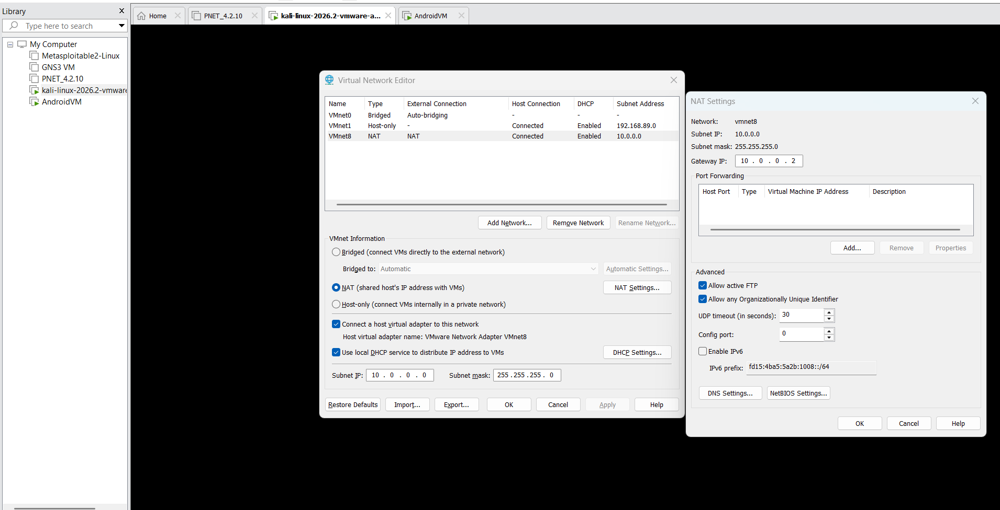

*Figure 1. VMware VMnet8 NAT settings.*

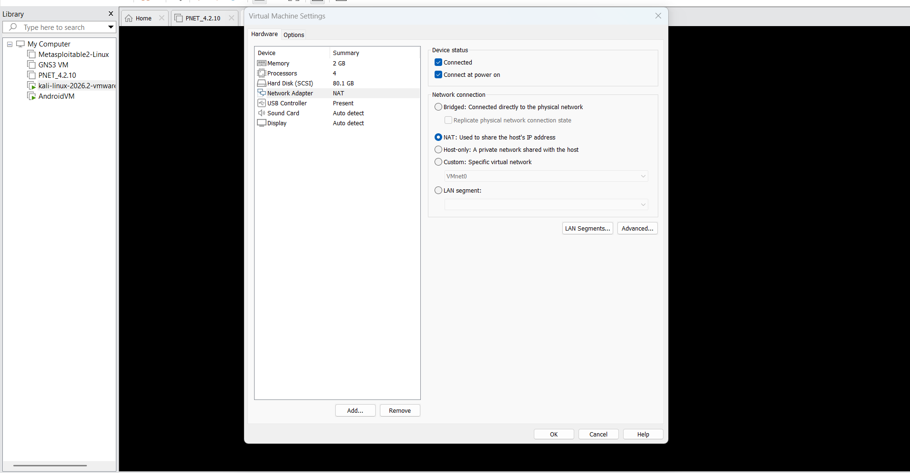

*Figure 2. Kali VM settings, including memory and network adapter.*

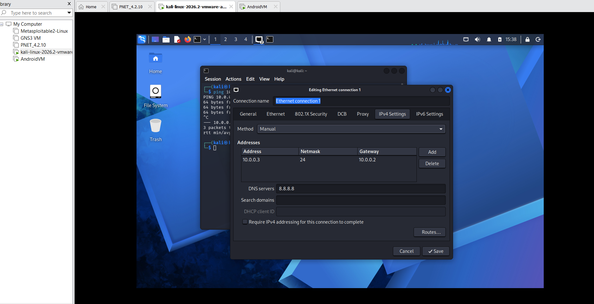

*Figure 3. Kali IPv4 configuration.*

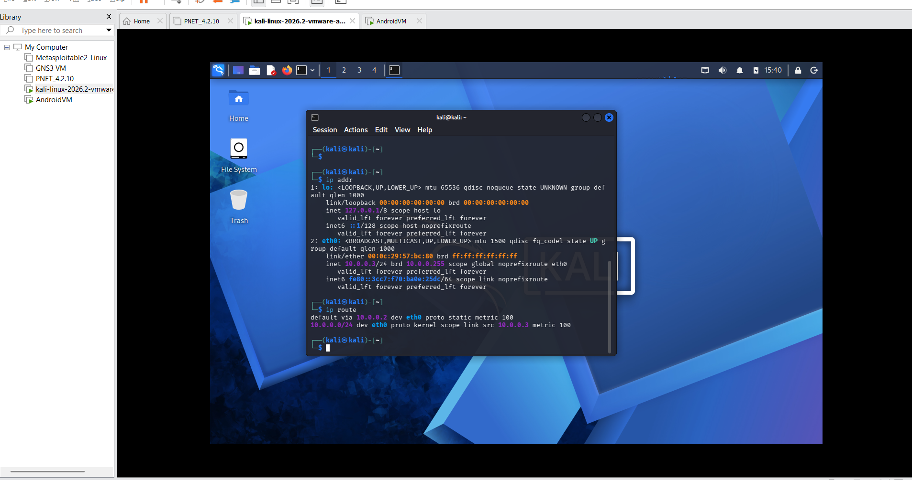

*Figure 4. Kali interface and routing information.*

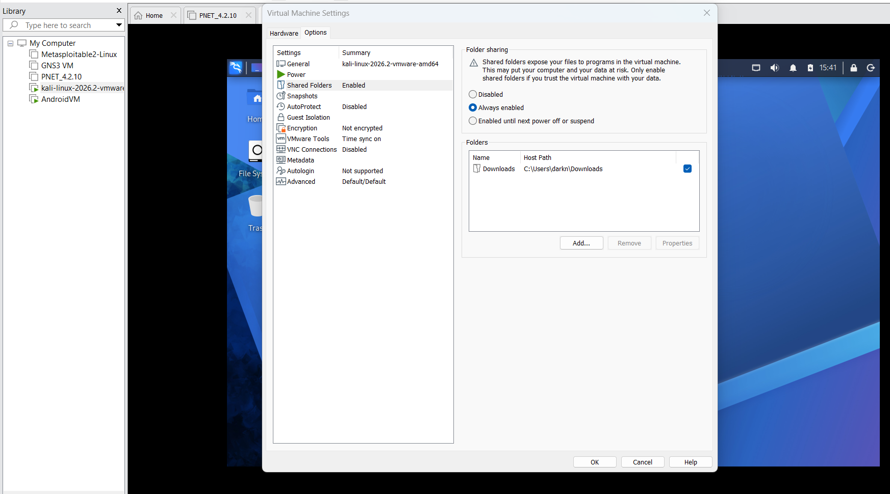

*Figure 5. Shared folder configuration, if available.*

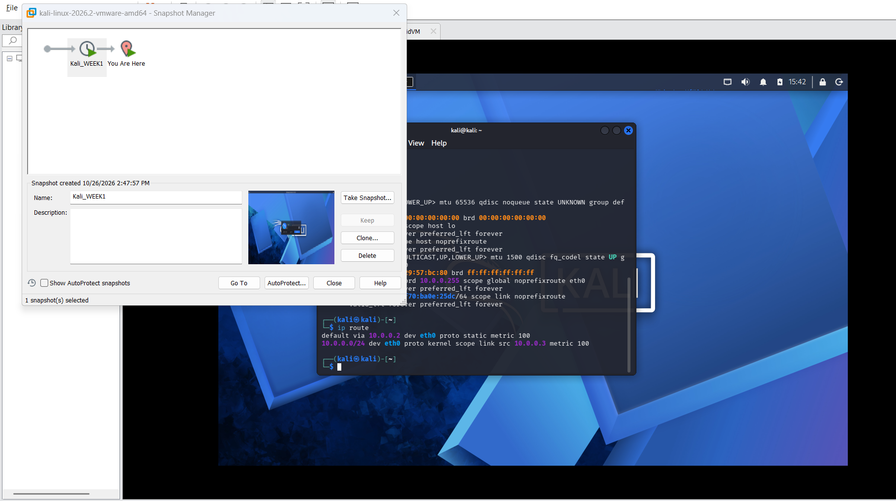

*Figure 6. Snapshot created after setup.*

## 4. Kali verification

| Check | Result |
|---|---|
| Interface configuration (`ip addr` / `ip -br addr`) | Inspected |
| Routing table (`ip route`) | Inspected |
| Ping to NAT gateway `10.0.0.2` | Successful |
| Ping to a public IP address | Successful |
| Opened YouTube in Kali's browser | Successful at the time of testing |
| Direct Kali-to-Android connectivity | Tested successfully; see Section 6 |

The successful browser test confirmed that Internet access and name resolution were working at the time. The network uses NAT and has not been established as an air-gapped environment.

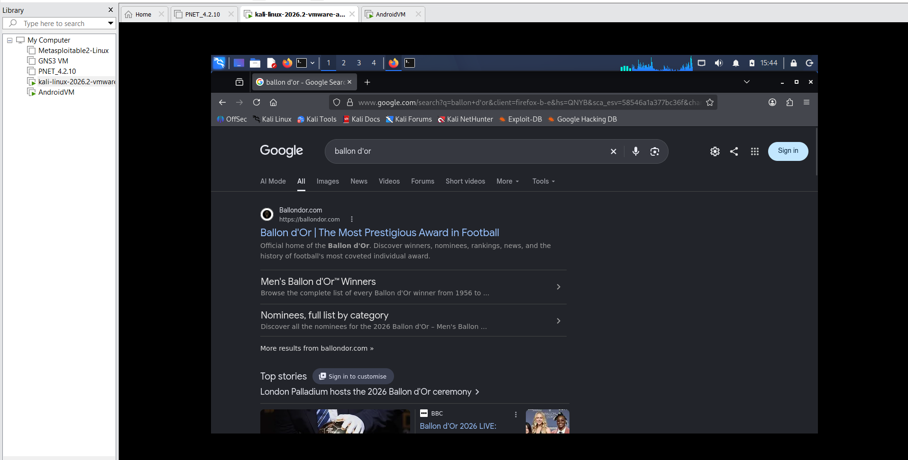

*Figure 7. Kali connectivity checks.*

## 5. Troubleshooting

### NetworkManager connection profile was inactive

**Problem:** I had configured the IP address on `eth0`, but connectivity was not working as expected.

**Cause:** The relevant NetworkManager connection profile was inactive.

**Resolution:** I activated the profile with:

```bash
sudo nmcli connection up "Ethernet connection 1"
```

This command brings up the named NetworkManager connection profile. It is not a firewall or port-opening command.

**Takeaway:** An interface having an IP address does not guarantee that the intended connection profile is active or that routes and DNS are working. Checking the active connection and routing table is useful when troubleshooting connectivity.


## 6. Additional virtual machines

### Android VM — completed

I configured the Android VM's network and verified both Internet access and connectivity with the Kali VM. This provided a second guest system for testing communication between virtual machines.

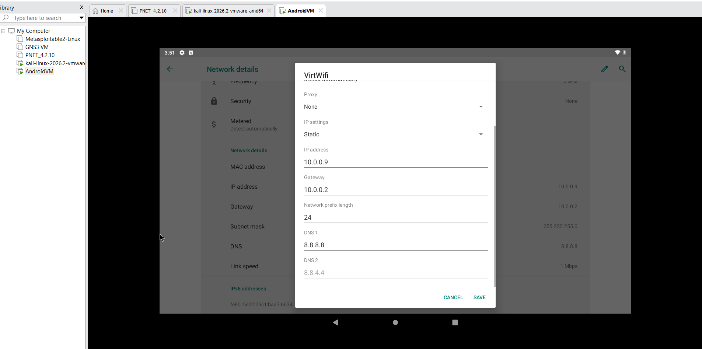

*Figure 8. Android VM network configuration.*

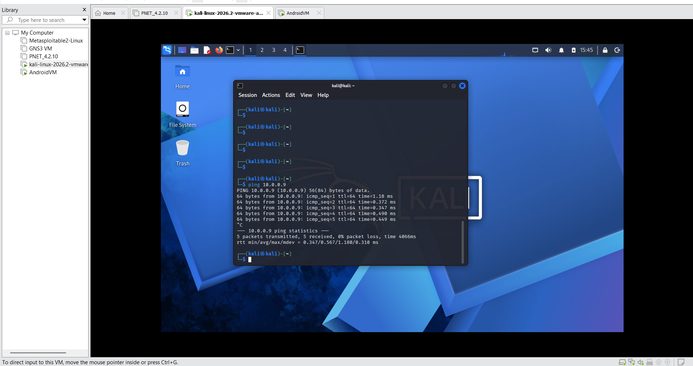

*Figure 9. Tests confirming Internet access and connectivity with Kali.*

### Windows VM — planned for the future

The Windows VM is **not installed yet** because I have been experiencing Internet issues at home. I plan to add it when the connection is stable enough to download and install the VM.

The intended process is the same general process used for the other VMs: configure the virtual network adapter, set up the required network settings, then test Internet access and direct connectivity with Kali and Android. These checks will be documented after the Windows VM is installed and tested; they are not claimed as completed.

## 7. Wireshark labs and quizzes — completed

I completed the six live Wireshark labs on the NetworkWalks portal. Each lab contained 10 tasks involving packet navigation, use of display filters, identifying and extracting different types of data, analyzing traffic patterns, and working with different protocols.

I also completed the basic Wireshark quiz and the advanced Wireshark quiz. Each quiz contained 10 questions across different lab environments. I passed both quizzes and saved screenshots showing the results, scores, and questions answered incorrectly.

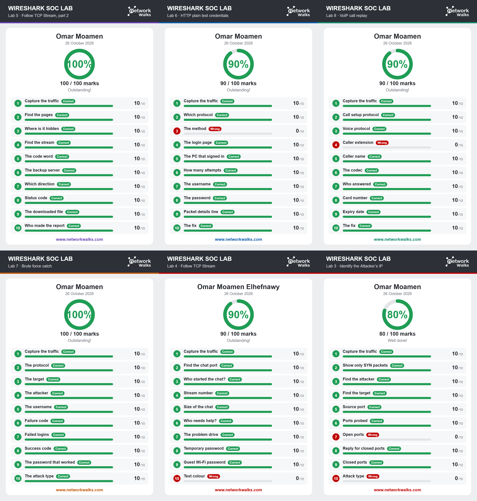

*Figure 10. Wireshark lab results.*

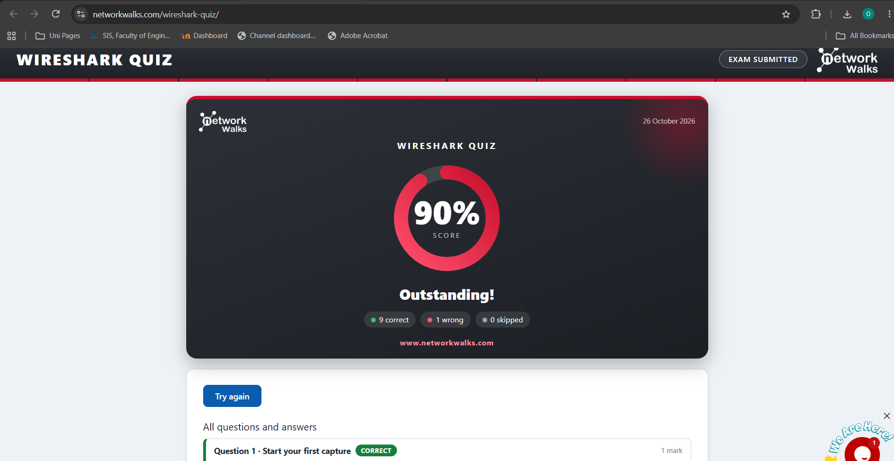

*Figure 11. Basic Wireshark quiz result.*

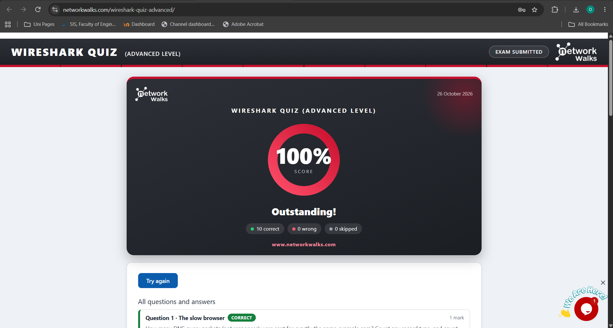

*Figure 12. Advanced Wireshark quiz result.*


## 8. Summary and next steps

**Completed**
- Configured Kali Linux in VMware Workstation Pro.
- Customized the VMnet8 NAT subnet and configured Kali's static IPv4 settings.
- Verified Kali's gateway and Internet connectivity.
- Configured a shared folder and created a snapshot.
- Configured Android VM networking and successfully tested Internet access and connectivity with Kali.
- Completed six live Wireshark labs and passed both the basic and advanced quizzes.

**Planned**
- Install and configure the Windows VM when home Internet access is reliable.
- Test Windows VM Internet access and connectivity with Kali and Android.

## 9. Safety and scope

This environment is intended for learning and authorized cybersecurity exercises. Only inspect or test systems and traffic you own or have explicit permission to assess. This setup uses NAT with Internet access; it should not be described as fully isolated or air-gapped.

## References

- [Kali Linux — Get Kali](https://www.kali.org/get-kali/)
- [VMware Workstation documentation](https://docs.vmware.com/en/VMware-Workstation-Pro/)
- [NetworkManager `nmcli` documentation](https://networkmanager.dev/docs/api/latest/nmcli.html)
